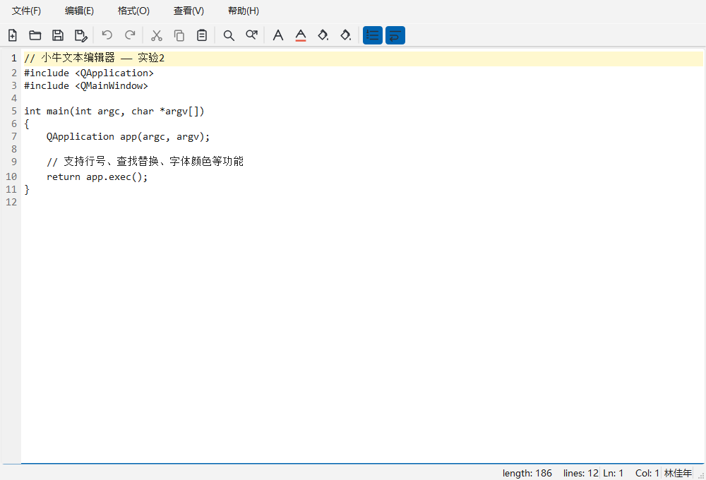

# 小牛文本编辑器（实验 2：简单文本编辑器）

基于 Qt Widgets 的多窗口文本编辑器，界面用 Qt Designer 完成，菜单/工具栏用
**Action 编辑器**创建并按功能分组；编辑区由 `QPlainTextEdit` 派生出带行号的
`CodeEditor`，在 `.ui` 中通过 **promote（提升）** 使用。



## 一、环境

| 项目 | 版本 |
| --- | --- |
| Qt | 6.11.2（mingw_64；实验指导书要求 Qt 5.12.11 及以上同理可用） |
| Qt Creator | 20.0.1 |
| 编译器 | MinGW GCC 13.1.0 |
| 构建系统 | qmake + mingw32-make |

## 二、用 Qt Creator 打开

1. `文件` → `打开文件或项目`，选择 `SimpleTextEditor.pro`；
2. 选择套件 `Desktop Qt 6.11.2 MinGW 64-bit`；
3. 点击 ▶ 运行。`mainwindow.ui`、`finddialog.ui`、`replacedialog.ui`、
   `aboutdialog.ui` 都可以直接双击进入 UI 设计器。

命令行构建：

```powershell
qmake ..\SimpleTextEditor.pro
mingw32-make -j4
.\release\SimpleTextEditor.exe
```

## 三、功能

| 分组 | 功能 |
| --- | --- |
| 文件 | 新建、打开、保存、另存为、退出；未保存关闭时提示；打不开/二进制文件有提示 |
| 编辑 | 撤销、恢复、剪切、复制、粘贴、全选、查找、替换 |
| 格式 | 自动换行、显示行号、字体、字体颜色、字体背景色、编辑器背景色 |
| 查看 | 显示/隐藏工具栏、状态栏 |
| 帮助 | 关于对话框 |

其它：

- 窗口标题随文件名和修改状态变化（`*` 表示未保存）；
- 状态栏实时显示 `length / lines / Ln / Col`；
- 撤销/重做/剪切/复制/粘贴的使能状态跟随当前编辑状态；
- 查找、替换支持向上/向下、区分大小写、连续查找（回绕）、全部替换；
- 行号栏高亮当前行，行号随文档行数自动调整宽度。

## 四、快捷键

| 快捷键 | 功能 |
| --- | --- |
| `Ctrl+N` | 新建 |
| `Ctrl+O` | 打开 |
| `Ctrl+S` | 保存 |
| `Ctrl+Shift+S` | 另存为 |
| `Ctrl+Z` / `Ctrl+Shift+Z` | 撤销 / 恢复 |
| `Ctrl+X` / `Ctrl+C` / `Ctrl+V` | 剪切 / 复制 / 粘贴 |
| `Ctrl+A` | 全选 |
| `Ctrl+F` / `Ctrl+H` | 查找 / 替换 |
| `Ctrl+L` | 显示/隐藏行号 |

## 五、项目结构

```
SimpleTextEditor.pro      qmake 工程
main.cpp                  程序入口、应用图标与字体
mainwindow.ui             主窗口：菜单、工具栏、动作、状态栏（Action 编辑器）
mainwindow.h/.cpp         文件/编辑/格式/查看/查找替换的业务逻辑
codeeditor.h/.cpp         从 QPlainTextEdit 派生的带行号控件
finddialog.ui/.h/.cpp     查找对话框
replacedialog.ui/.h/.cpp  替换对话框
aboutdialog.ui/.h/.cpp    关于对话框
resources.qrc + icons/    工具栏与窗口图标（SVG）
tests/                    QtTest 自动化测试
tools/shots/              生成运行截图的辅助程序
docs/                     实验报告与截图
```

## 六、测试

```powershell
mkdir build-tests
cd build-tests
qmake ..\tests\tests.pro
mingw32-make -j4
.\release\tst_editor.exe -o result.txt,txt
```

共 15 个测试用例，覆盖：初始状态、状态栏行列、修改标题、行号开关、自动换行、
撤销重做、复制剪切使能、保存/打开往返、另存为对话框、文件不存在、二进制文件、
查找回绕、全部替换、关闭时取消/放弃。

> Windows 下 `QTest` 的输出默认不显示在控制台，需要用 `-o 结果文件,txt`。

## 七、说明

关于对话框与状态栏中的作者信息为：林佳年 / 2024414290218 / 2811283369@qq.com，
如需修改可在 `aboutdialog.ui` 的 `labelInfo` 与 `mainwindow.cpp` 的
`createStatusBarWidgets()` 中调整。
