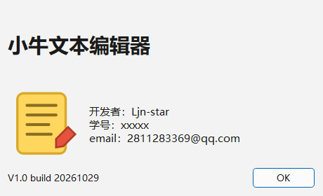
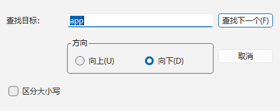
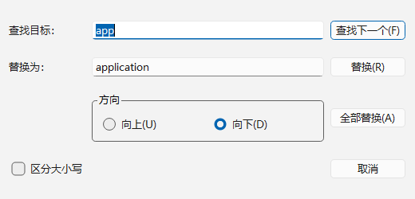

# 实验报告：简单文本编辑器

## 一、实验目标

1. 掌握混合式 UI 设计的方法（UI 设计器 + 代码）；
2. 掌握工具栏的创建和使用，会利用 Action 添加工具和菜单；
3. 掌握多窗口应用程序设计的基本原理和方法；
4. 掌握文本文件的读写操作；
5. 合理使用 AI Coding 工具辅助开发，并通过运行、边界测试和代码分析验证结果。

## 二、实验环境

| 项目 | 内容 |
| --- | --- |
| 操作系统 | Windows 11 64 位 |
| 开发工具 | Qt Creator 20.0.1 |
| Qt 版本 | Qt 6.11.2（mingw_64） |
| 编译器 | MinGW GCC 13.1.0 |
| 构建系统 | qmake |
| 版本控制 | Git |

## 三、实验步骤及结果

### 3.1 UI 布局与设计

主窗口用 Qt Designer 完成：`QMainWindow` 中央放置一个 `QVBoxLayout`，布局的
`leftMargin/topMargin/rightMargin/bottomMargin` 全部设为 **0**，里面只放一个
编辑控件 `textEdit`。这样文本区可以占满窗口，不会出现默认的 9px 边距。

菜单与工具栏通过 **Action 编辑器** 创建，按功能分组：

- 文件：新建、打开、保存、另存为、退出；
- 编辑：撤销、恢复、剪切、复制、粘贴、查找、替换、全选；
- 格式：自动换行、显示行号、字体、字体颜色、字体背景色、编辑器背景色；
- 查看：工具栏、状态栏；
- 帮助：关于。

关键代码（`mainwindow.ui`，节选）：

```xml
<widget class="QWidget" name="centralWidget">
 <layout class="QVBoxLayout" name="verticalLayout">
  <property name="spacing"><number>0</number></property>
  <property name="leftMargin"><number>0</number></property>
  <property name="topMargin"><number>0</number></property>
  <property name="rightMargin"><number>0</number></property>
  <property name="bottomMargin"><number>0</number></property>
  <item>
   <widget class="CodeEditor" name="textEdit"/>
  </item>
 </layout>
</widget>
```

编辑区使用从 `QPlainTextEdit` 派生的 `CodeEditor`，在 Designer 里通过
**"提升为"（promote）** 使用：

```xml
<customwidgets>
 <customwidget>
  <class>CodeEditor</class>
  <extends>QPlainTextEdit</extends>
  <header>codeeditor.h</header>
 </customwidget>
</customwidgets>
```

运行结果：


### 3.2 关于对话框

`aboutdialog.ui` 由标题、应用图标、开发者信息、版本号和 OK 按钮组成，
在 `MainWindow::on_actionAbout_triggered()` 中以模态方式打开：

```cpp
void MainWindow::on_actionAbout_triggered()
{
    AboutDialog dialog(this);
    dialog.exec();
}
```



### 3.3 查找对话框

查找对话框包含查找目标输入框、查找下一个按钮、方向单选（向上/向下）、
区分大小写复选框和取消按钮。查找从当前光标位置开始，找不到时自动从
文档首/尾回绕一次，实现连续查找：

```cpp
if (!m_editor->find(target, flags)) {
    QTextCursor cursor = m_editor->textCursor();
    cursor.movePosition(backward ? QTextCursor::End : QTextCursor::Start);
    m_editor->setTextCursor(cursor);
    if (!m_editor->find(target, flags))
        QMessageBox::information(this, tr("查找"), tr("未找到“%1”。").arg(target));
}
```



### 3.4 替换对话框

替换对话框在查找对话框基础上增加"替换为""替换""全部替换"。
全部替换用 `QTextDocument::find()` 循环完成，并用 `beginEditBlock()` 把整个
替换过程合并成一次可撤销的操作：

```cpp
QTextCursor cursor(m_editor->document());
if (flags & QTextDocument::FindBackward)
    cursor.movePosition(QTextCursor::End);
cursor.beginEditBlock();

int count = 0;
QTextCursor found = m_editor->document()->find(target, cursor, flags);
while (!found.isNull()) {
    found.insertText(replacement);
    ++count;
    found = m_editor->document()->find(target, found, flags);
}
cursor.endEditBlock();
```



### 3.5 新建/打开/保存/另存为

文件操作统一走 `loadFile()` / `saveFile()`：

- 新建：若有未保存修改先 `maybeSave()`，然后清空并重置标题；
- 打开：文件不存在、无法读取、包含二进制数据（`\0`）、超过 20MB 时给出提示并
  保持原内容不变；
- 保存：未命名时转去"另存为"，否则直接写回当前文件；
- 另存为：用户未写扩展名时自动补 `.txt`；
- 关闭窗口：`closeEvent()` 调用 `maybeSave()`，提供保存/不保存/取消三种选择。

```cpp
bool MainWindow::maybeSave()
{
    if (!ui->textEdit->document()->isModified())
        return true;
    const auto ret = QMessageBox::warning(this, tr("提示"), tr("文档已修改，是否保存？"),
                                          QMessageBox::Save | QMessageBox::Discard
                                          | QMessageBox::Cancel);
    if (ret == QMessageBox::Save) {
        if (m_currentFile.isEmpty()) {
            on_actionSaveAs_triggered();
            return !ui->textEdit->document()->isModified();
        }
        return saveFile(m_currentFile);
    }
    return ret != QMessageBox::Cancel;
}
```

窗口标题使用 `[*]` 占位符，未保存时自动显示 `*`：

```cpp
setWindowTitle(tr("%1[*] - 编辑器").arg(name));
```

### 3.6 撤销/恢复/剪切/复制/粘贴/全选

动作直接委托给 `QPlainTextEdit` 的对应槽函数，使能状态由编辑控件信号驱动：

```cpp
connect(ui->textEdit, &QPlainTextEdit::undoAvailable,
        ui->actionUndo, &QAction::setEnabled);
connect(ui->textEdit, &QPlainTextEdit::redoAvailable,
        ui->actionRedo, &QAction::setEnabled);
connect(ui->textEdit, &QPlainTextEdit::copyAvailable,
        ui->actionCopy, &QAction::setEnabled);
connect(ui->textEdit, &QPlainTextEdit::copyAvailable,
        ui->actionCut, &QAction::setEnabled);
```

粘贴按钮的使能状态跟随剪贴板是否有文本变化（`QClipboard::dataChanged`）。

### 3.7 字体、字体颜色、背景色、自动换行

- 字体：`QFontDialog::getFont()` 选择后 `setFont()`；
- 字体颜色 / 字体背景色：`QColorDialog` + `QTextCharFormat` +
  `mergeCurrentCharFormat()`，有选区时只作用于选区；
- 编辑器背景色：修改 `QPalette::Base`，并在深色背景时自动把文字改为浅色；
- 自动换行：`setLineWrapMode(WidgetWidth / NoWrap)`。

```cpp
void MainWindow::on_actionEditorBgColor_triggered()
{
    const QColor color = QColorDialog::getColor(
        ui->textEdit->palette().color(QPalette::Base), this, tr("选择编辑器背景色"));
    if (color.isValid())
        ui->textEdit->setEditorBackgroundColor(color);
}
```

### 3.8 工具栏/状态栏与状态信息

"查看"菜单中的两个 Action 可分别显示/隐藏工具栏和状态栏。
状态栏用三个常驻 `QLabel` 显示长度、行数、行列号和作者：

```cpp
void MainWindow::updateStatusBar()
{
    const int length = ui->textEdit->toPlainText().length();
    const int lines = ui->textEdit->document()->blockCount();
    m_statusLabel->setText(tr("length: %1    lines: %2").arg(length).arg(lines));

    const QTextCursor cursor = ui->textEdit->textCursor();
    m_cursorLabel->setText(tr("Ln: %1    Col: %2")
                               .arg(cursor.blockNumber() + 1)
                               .arg(cursor.columnNumber() + 1));
}
```

### 3.9 查找与替换功能

查找支持向上/向下、区分大小写；找不到时提示"未找到"，第三次查找会从
文档开头回绕，验证连续查找正确。替换单次替换后自动查找下一个；
全部替换会统计替换次数并提示结果。

### 3.10 行号控件（CodeEditor）

参考 Qt Code Editor Example，从 `QPlainTextEdit` 派生 `CodeEditor`：

- `lineNumberAreaWidth()` 根据最大行号计算行号栏宽度；
- `updateLineNumberAreaWidth()` 用 `setViewportMargins()` 给行号栏留出位置；
- `lineNumberAreaPaintEvent()` 在行号栏里绘制行号；
- `highlightCurrentLine()` 用 `ExtraSelection` 高亮当前行；
- `setLineNumberVisible()` 控制行号显示/隐藏。

```cpp
void CodeEditor::updateLineNumberAreaWidth(int /*newBlockCount*/)
{
    setViewportMargins(lineNumberAreaWidth(), 0, 0, 0);
}
```

## 四、边界与异常测试

| # | 测试输入 | 程序现象 | 原因分析 | 修改后结果 |
| --- | --- | --- | --- | --- |
| 1 | 打开不存在的文件 | 弹出"文件不存在或不是普通文件" | 未检查 `QFileInfo::exists()` | 保持原文档不变，给出提示 |
| 2 | 打开含 `\0` 的二进制文件 | 弹出"不是纯文本文件" | 直接按文本读取会出现乱码 | 检测到 `\0` 拒绝打开 |
| 3 | 修改后点关闭，选择"取消" | 窗口保持打开 | 需要区分保存/不保存/取消 | `closeEvent` 忽略关闭事件 |
| 4 | 修改后点关闭，选择"不保存" | 窗口正常关闭 | — | 通过 `Discard` 分支 |
| 5 | 保存含中文/换行的文件再打开 | 内容一致，无额外字符 | Windows 下写入为 CRLF | 读取时把 CRLF/CR 统一成 LF |
| 6 | 查找不存在的文本 | 提示"未找到" | 已完成回绕仍找不到 | 不改变选中内容 |
| 7 | 替换目标为空字符串 | 提示"请输入要查找的内容" | 空串会导致死循环 | 直接返回 |
| 8 | 任意替换（含替换文本包含目标） | 正常结束 | 替换后游标在替换文本之后 | 不会死循环 |

## 五、GitHub 日志

仓库地址：<https://github.com/Ljn-star/qt>

仓库按功能分阶段提交，共 8 次：

1. `chore: 初始化 qmake 工程与图标资源`
2. `feat(ui): 主窗口菜单、工具栏、状态栏与编辑区布局`
3. `feat(core): 带行号的 CodeEditor 文本编辑控件`
4. `feat(main): 文件/编辑/格式/查看操作与标题、状态栏联动`
5. `feat(dialog): 关于、查找、替换对话框与查找替换逻辑`
6. `test: 增加 QtTest 自动化测试与运行截图`
7. `docs: 添加 README 与实验报告`
8. `feat(ui): 填写关于对话框与状态栏的作者信息`

## 六、测试结果

`tests/tests.pro` 共 15 个用例，全部通过：

```
PASS   : TestEditor::initialStatus()
PASS   : TestEditor::statusUpdatesWhileTyping()
PASS   : TestEditor::modifiedTitle()
PASS   : TestEditor::lineNumberToggle()
PASS   : TestEditor::wordWrapToggle()
PASS   : TestEditor::undoRedoActions()
PASS   : TestEditor::copyEnabledWithSelection()
PASS   : TestEditor::saveAndOpenFile()
PASS   : TestEditor::saveAsDialogIntegration()
PASS   : TestEditor::loadNonexistentFile()
PASS   : TestEditor::rejectBinaryFile()
PASS   : TestEditor::findDialogFindsAndWraps()
PASS   : TestEditor::replaceAllCounts()
PASS   : TestEditor::closeCancelKeepsWindow()
PASS   : TestEditor::closeDiscardClosesWindow()
Totals: 17 passed, 0 failed
```

## 七、实验总结

### 7.1 出错分析与解决

1. **保存后读回内容多出 `\r`**：Windows 下 `QIODevice::Text` 把 `\n` 写成
   `\r\n`，`setPlainText()` 读取原始字节后又保留了 `\r`。解决：加载时把
   `\r\n` 和单独的 `\r` 统一替换为 `\n`。
2. **工具栏图标不显示**：`resources.qrc` 的前缀写成 `/icons`，文件路径又是
   `icons/new.svg`，实际资源路径变成了 `:/icons/icons/new.svg`。解决：前缀改为 `/`。
3. **窗口标题多出一段应用名**：`setApplicationDisplayName()` 会被 Qt 追加到
   标题后面。解决：去掉该调用，标题只保留"文件名[*] - 编辑器"。
4. **QPlainTextEdit 没有 `textColor()`**：那是 `QTextEdit` 的接口。解决：改用
   `currentCharFormat().foreground().color()` 取初始颜色。
5. **全部替换可能死循环**：替换文本中包含查找文本时，若游标不前进会反复命中。
   解决：`insertText()` 后从替换文本之后继续查找，并用空目标保护。

### 7.2 本次实验总结

- 掌握了 Qt Designer 中 Action 编辑器、菜单、工具栏的配合方式；
- 理解了 `QPlainTextEdit` 的文档/游标模型，能通过 `QTextCursor` 完成查找替换；
- 学会了从控件派生自定义类并通过 promote 在 `.ui` 中使用；
- 体会到"文件状态 → 标题/按钮使能 → 用户提示"这条状态链的重要性。

### 7.3 AI 辅助开发记录

- **问题**：除零之外，本次最典型的问题是"关闭未保存文档"与"保存/另存为"
  的流程容易写乱；
- **提示词**：描述 `maybeSave()` 的预期（保存/不保存/取消三种结果），要求
  说明每种情况下返回值与后续动作；
- **AI 方案**：用 `QMessageBox::Save | Discard | Cancel`，保存失败时返回 false，
  取消另存为时不清除修改标志；
- **运行验证**：用 QtTest 自动点击"取消"和"不保存"按钮，分别断言窗口保持/
  关闭；发现保存后读回存在 CRLF 问题，补充了换行归一化；
- **自己的修改**：把文件读写抽成 `loadFile()`/`saveFile()` 公开接口，便于测试；
  给打开文件的异常路径（不存在、二进制、过大）分别加了中文提示。

## 八、测试视频建议

1. 新建 → 输入文字 → 标题出现 `*`；
2. 保存/另存为 → 打开刚保存的文件；
3. 修改后关闭 → 演示"取消"与"不保存"；
4. 查找、连续查找、替换、全部替换；
5. 撤销/重做、剪切/复制/粘贴；
6. 字体/颜色/背景色/自动换行/行号开关；
7. 打开不存在的文件（异常场景）；
8. `git log --oneline --graph` 展示提交历史。
